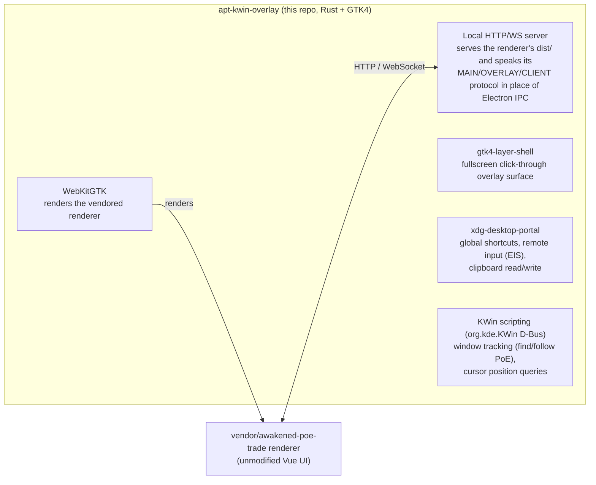

# apt-kwin-overlay

A native KWin/Wayland backend for [Awakened PoE Trade](https://github.com/SnosMe/awakened-poe-trade) (APT).

APT's overlay uses Electron and X11 APIs for hotkeys, click-through, input
injection and clipboard capture, so it doesn't work under Wayland. This
project replaces APT's Electron `main` process with a small Rust/GTK4 host
that uses Wayland and KDE APIs instead. The host runs APT's unmodified Vue
renderer, vendored as a git submodule, and talks to it over the same
WebSocket and HTTP protocol. The build uses only the submodule's
`renderer/`, never its `main/`.

## How it works



Each module in `src/` reimplements one part of APT's `main/src/*`, enough
for the renderer to work as it does under Electron:

| Module | Replaces (upstream `main/src/*`) | Does |
|---|---|---|
| `main.rs` | window-management parts of `OverlayWindow.ts` | Builds the layer-shell surface, toggles click-through and keyboard focus, and handles Escape and Ctrl+W while a widget is interactive. Injects `hotkey_ui_info.js`, which points the renderer's Hotkeys settings at KDE |
| `server.rs` | `server.ts`, IPC bus | Serves the renderer's `dist/` over HTTP and runs the WebSocket event bus that replaces Electron IPC |
| `ipc.rs` | `ipc/types.ts` | Defines every WebSocket event and the `/config` body as Rust types. `cargo test` checks them against upstream's TypeScript with `tsc` |
| `shortcuts.rs` | `shortcuts/Shortcuts.ts` | Registers the renderer's configured hotkeys with the `GlobalShortcuts` portal and runs their actions, such as price-check, toggle-overlay and copy-item. Closes the popup when the cursor leaves it |
| `host_config.rs` | config parsing parts of `Shortcuts.ts`/`ConfigStore.ts` | Parses the renderer's `update-host-config` shortcut list and `restoreClipboard` flag. Registers every configurable action with KDE up front, so each one can be bound in System Settings → Shortcuts |
| `remote_input.rs` | `HostClipboard.ts`, synthetic key presses | Presses Ctrl+C, reads the clipboard until item text appears, and restores the old contents. Uses the `RemoteDesktop`/`ConnectToEIS` and `Clipboard` portals (libei), the only portal-sanctioned way to inject input or use the clipboard on Wayland |
| `kwin_tracker.rs` | window-tracking parts of `OverlayWindow.ts` | Runs a persistent KWin script over D-Bus that reports window activation and geometry. Uses it to find PoE, follow it across monitors and reset the overlay when PoE regains focus. Also queries the cursor position |
| `proxy.rs` | `proxy.ts` | Forwards renderer requests to poe.ninja and pathofexile.com, with upstream's host allowlist and User-Agent override |
| `config_store.rs` | `ConfigStore.ts` | Saves the renderer's settings to disk without parsing them |
| `uploads.rs` | upload handling | Stores uploaded screenshots and images and serves them over HTTP |
| `logger.rs` | `RemoteLogger.ts` | Keeps an in-memory log and replays it to each new WebSocket client |

## Status

This is an early working version, not a polished release. Compared with APT,
it has no Ctrl+scroll stash-tab navigation, no `logKeys` key logging, no
game-log watcher, no Windows-only OCR and no self-updater. The pinned
renderer discards game-log lines anyway.

## Requirements

- KDE Plasma on Wayland. The host needs KWin's scripting D-Bus interface
  and `xdg-desktop-portal-kde`. Other compositors and portal backends are
  untested and probably won't work.
- Rust with the 2024 edition
- The `webkitgtk-6.0` and `gtk4-layer-shell` libraries, plus their dev
  packages if your distro ships them separately
- Node.js and npm, to build the renderer and to run `cargo test`, which uses
  the renderer's `tsc`

## Building

```sh
git submodule update --init

# Builds the unmodified renderer. Run it once, and again after updating
# the submodule.
./scripts/build-renderer.sh

cargo build --release
```

### Testing

Run `./scripts/build-renderer.sh` once before testing.

```sh
cargo test
```

Along with the unit tests, `cargo test` checks the Rust code against the
vendored upstream. It exports the event types in `src/ipc.rs` to TypeScript
and type-checks them with `tsc` against `ipc/types.ts`. Then
`tests/upstream_contract.rs` checks that the renderer still has the text and
markup the injected Settings script looks for.

### Installing on Arch with the PKGBUILD

```sh
git clone https://github.com/thwonghin/apt-kwin-overlay.git
cd apt-kwin-overlay
makepkg -si
```

This installs the `apt-kwin-overlay` binary to `/usr/bin` and the renderer
to `/usr/share/apt-kwin-overlay/dist`.

## Running

```sh
cargo run --release
```

On first run, KDE's portal asks for four permissions. Hotkeys and
price-check need all of them.

- Global shortcuts
- Remote desktop, to inject input
- Screencast, which comes with the remote desktop session
- Clipboard access

The overlay is a transparent, click-through layer-shell surface that stays
above other windows. It uses stock APT's default hotkeys. Shift+Space
toggles the overlay, Ctrl+D runs a price-check and Ctrl+Alt+D runs a locked
price-check. Escape or Ctrl+W closes an open popup.

To change hotkeys, open KDE's System Settings → Shortcuts and search for
"apt-kwin-overlay". APT's own Hotkeys and Item Info settings tabs show a
banner pointing there instead. KDE's `GlobalShortcuts` portal gives the app
no way to rebind a key the user already granted, which Electron's
global-shortcut API could do. The doc comments in `host_config.rs` have the
details.

To troubleshoot, run `APT_KWIN_OVERLAY_DEBUG=1 cargo run --release`. The
terminal then also shows window activations, hotkey dispatch and popup
tracking.

## License

MIT, see [LICENSE](LICENSE). The vendored `awakened-poe-trade` submodule has
its own MIT license.
