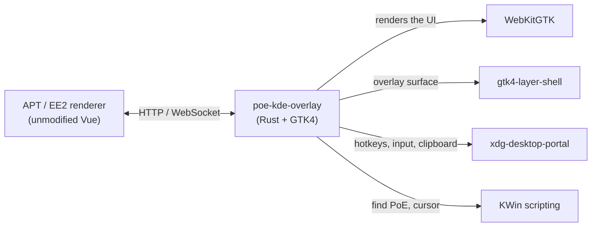

# poe-kde-overlay

A native KWin/Wayland backend for the Path of Exile price-check overlays on
Linux: [Awakened PoE Trade](https://github.com/SnosMe/awakened-poe-trade) (APT) for
PoE1 and its fork [Exiled Exchange 2](https://github.com/kvan7/Exiled-Exchange-2)
(EE2) for PoE2.

> [!WARNING]
> Everything in this repo except the vendored submodules (`vendor/`) is
> LLM-written ("vibe coded"). It has had only light human review and has
> been tested on one KDE setup. Use it at your own risk.

APT's overlay uses Electron and X11 APIs for hotkeys, click-through, input
injection and clipboard capture, so it doesn't work under Wayland. This
project replaces APT's Electron `main` process with a small Rust/GTK4 host
that uses Wayland and KDE APIs instead. The host runs both apps' unmodified Vue
renderers, vendored as git submodules, and talks to them over the same
WebSocket and HTTP protocol. The build uses only each submodule's
`renderer/`, never its `main/`.

The two games are equal peers. Each gets its own local server, settings and
uploads (`~/.local/share/poe-kde-overlay/poe1/` and `poe2/`). The overlay
shows the renderer of whichever game is focused, and reloads to the other
one when you switch games. The tray menu opens either game's settings in
the browser at any time. Hotkeys are shared: one KDE binding works in both
games.

## How it works



Each module in `src/` reimplements one part of APT's and EE2's
`main/src/*`, enough for the renderers to work as they do under Electron:

| Module | Replaces (upstream `main/src/*`) | Does |
|---|---|---|
| `game.rs` | — | The two games (poe1/poe2): each one's renderer, data dir and window caption |
| `main.rs` | window-management parts of `OverlayWindow.ts` | Loads the focused game's renderer, builds the layer-shell surface, toggles click-through and keyboard focus, and handles Escape and Ctrl+W while a widget is interactive. Injects `hotkey_ui_info.js`, which points the renderer's Hotkeys settings at KDE |
| `server.rs` | `server.ts`, IPC bus | One server per game. Serves that renderer's `dist/` over HTTP and runs the WebSocket event bus that replaces Electron IPC |
| `ipc.rs` | `ipc/types.ts` | Defines every WebSocket event and the `/config` body as Rust types. `cargo test` checks them against upstream's TypeScript with `tsc` |
| `shortcuts.rs` | `shortcuts/Shortcuts.ts` | Registers the renderer's configured hotkeys with the `GlobalShortcuts` portal and runs their actions, such as price-check, toggle-overlay and copy-item. Remembers every bound shortcut across launches, so KDE doesn't re-ask about them. Closes the popup when the cursor leaves it |
| `host_config.rs` | config parsing parts of `Shortcuts.ts`/`ConfigStore.ts` | Parses the renderer's `update-host-config`: shortcuts, `restoreClipboard`, and the game-log, game-config and PoE2-only options. Registers every configurable action with KDE up front, so each one can be bound in System Settings → Shortcuts |
| `remote_input.rs` | `HostClipboard.ts`, synthetic key presses | Presses Ctrl+C (plus PoE2's advanced-descriptions key), reads the clipboard until item text appears, and restores the old contents. Uses the `RemoteDesktop`/`ConnectToEIS` and `Clipboard` portals (libei), the only portal-sanctioned way to inject input or use the clipboard on Wayland |
| `game_config.rs` | `host-files/GameConfig.ts` | Reads PoE2's advanced-descriptions key from `poe2_production_Config.ini`, found in the running game's Wine prefix if not configured |
| `game_log.rs` | `host-files/GameLogWatcher.ts` | Tails each game's `Client.txt` (found through the game's own open files if not configured) and sends new lines to the renderer |
| `library.rs` | `host-files/FileWriter.ts` | PoE2's experimental item library: writes library sessions to CSV and parsed game-log events to `client-log.ndjson` |
| `overlay_visibility.rs` | `windowing/OverlayVisibility.ts` | Hides the overlay while Alt is held on its own |
| `kwin_tracker.rs` | window-tracking parts of `OverlayWindow.ts` | Runs a persistent KWin script over D-Bus that reports window activation and geometry. Uses it to find PoE, tell PoE1 from PoE2 by window title, follow it across monitors and reset the overlay when PoE regains focus. Also queries the cursor position |
| `proxy.rs` | `proxy.ts` | Forwards renderer requests to poe.ninja and pathofexile.com, with upstream's host allowlist and User-Agent override |
| `config_store.rs` | `ConfigStore.ts` | Saves the renderer's settings to disk without parsing them |
| `uploads.rs` | upload handling | Stores uploaded screenshots and images and serves them over HTTP |
| `logger.rs` | `RemoteLogger.ts` | Keeps an in-memory log and replays it to each new WebSocket client |

## Status

This is an early working version, not a polished release. Compared with APT
and EE2, it has no Ctrl+scroll stash-tab navigation, no `logKeys` key
logging, no Windows-only OCR and no self-updater. A hotkey pressed during
the 1–2 s reload after switching games is lost.

## Requirements

- KDE Plasma on Wayland. The host needs KWin's scripting D-Bus interface
  and `xdg-desktop-portal-kde`. Other compositors and portal backends are
  untested and probably won't work.
- Rust with the 2024 edition
- The `webkitgtk-6.0` and `gtk4-layer-shell` libraries, plus their dev
  packages if your distro ships them separately
- Node.js and npm, to build the renderers and to run `cargo test`, which uses
  the renderers' `tsc`

## Building

```sh
git submodule update --init

# Builds both unmodified renderers. Run it once, and again after updating
# either submodule.
./scripts/build-renderer.sh

cargo build --release
```

### Testing

Run `./scripts/build-renderer.sh` once before testing.

```sh
cargo test
```

Along with the unit tests, `cargo test` checks the Rust code against both
vendored upstreams. It exports the event types in `src/ipc.rs` to TypeScript
and type-checks them with each vendor's `tsc` against its `ipc/types.ts`.
Drift tests check that the item-text signatures, proxy allowlist, copy-item
targets, guessed game-log and game-config paths, and PoE2's key codes still
match both vendors' `main/` and `ipc/`. Then `tests/upstream_contract.rs`
checks that both renderers still have the text and markup the injected
Settings script looks for.

### Installing on Arch with the PKGBUILD

```sh
git clone https://github.com/thwonghin/poe-kde-overlay.git
cd poe-kde-overlay
makepkg -si
```

This installs the `poe-kde-overlay` binary to `/usr/bin` and the renderers
to `/usr/share/poe-kde-overlay/poe1` and `poe2`.

## Running

```sh
cargo run --release
```

On first run, KDE's portal asks for four permissions. Hotkeys and
price-check need all of them.

- Global shortcuts
- Remote desktop, to inject input
- Screencast, which comes with the remote desktop session
- Clipboard access

The overlay is a transparent, click-through layer-shell surface that stays
above other windows. It uses stock APT's default hotkeys. Shift+Space
toggles the overlay, Ctrl+D runs a price-check and Ctrl+Alt+D runs a locked
price-check. Escape or Ctrl+W closes an open popup.

To change hotkeys, open KDE's System Settings → Shortcuts and search for
"poe-kde-overlay". Both renderers' Hotkeys and Item Info settings tabs show a
banner pointing there instead; non-hotkey settings on those tabs (such as
PoE2's search-same-priced "Filter by") stay editable. KDE's
`GlobalShortcuts` portal gives the app no way to rebind a key the user
already granted, which Electron's global-shortcut API could do. The doc comments in `host_config.rs` have the
details.

To troubleshoot, run `POE_KDE_OVERLAY_DEBUG=1 cargo run --release`. The
terminal then also shows window activations, hotkey dispatch and popup
tracking.

## License

MIT, see [LICENSE](LICENSE). The vendored `awakened-poe-trade` and
`exiled-exchange-2` submodules each have their own MIT license.
